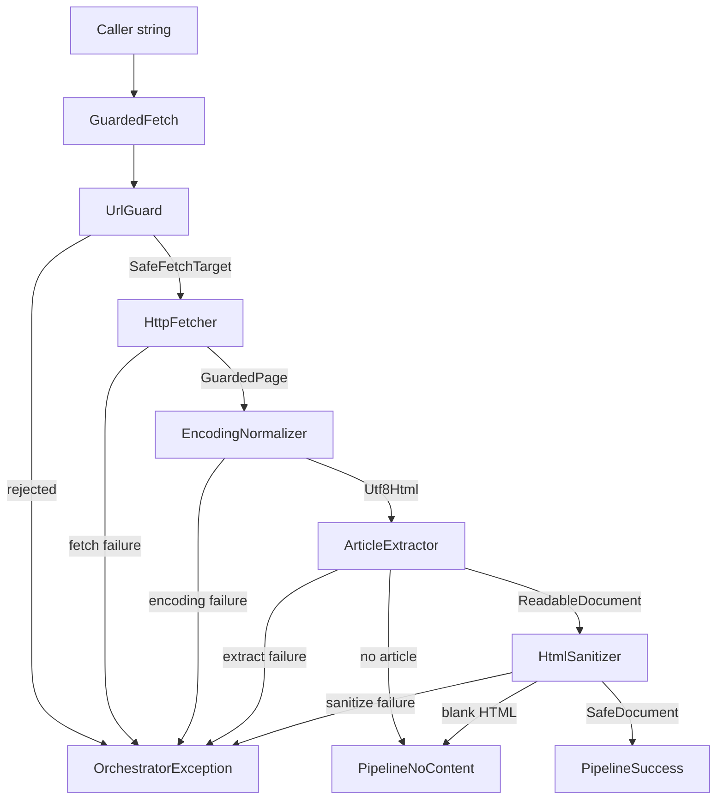

# Flow: fetch article

The path of one `Orchestrator::fetchArticle()` call, from the caller string to a finished result or a thrown failure.

Policies are chosen earlier, when `OrchestratorFactory::create()` builds the stages. `fetchArticle()` receives only the URL string.

## Diagram

`Orchestrator` keeps `originalUrl` and `hopHistory` from `GuardedPage` in local variables. Encoding, extraction, and purification see only the page body and its `sourceUrl`. Those two locals are copied onto `PipelineSuccess` and dropped for `PipelineNoContent`.

## What each step passes on

| Step | Receives | Passes on | Does not pass on |
| --- | --- | --- | --- |
| GuardedFetch | The caller string. | A `GuardedPage`: the downloaded page, `originalUrl` equal to that string, and `hopHistory` as the request URLs left behind. | `GuardResult.original`. The caller string is the one `GuardedFetch` stored. |
| UrlGuard | The caller string. | `SafeFetchTarget`: canonical request URL plus the pinned public IPs. | The caller string. |
| HttpFetcher | One `SafeFetchTarget`. | `FetchedPage` for a 2xx, or a `RedirectResponse` for a 3xx. `requestUri` on the page is that canonical URL. | The next hop. One request does not follow a redirect. |
| EncodingNormalizer | `FetchedPage`. | `Utf8Html`. `sourceUrl` is `requestUri`. | `originalUrl` and `hopHistory`. |
| ArticleExtractor | `Utf8Html`. | `ReadableDocument.sourceUrl`, or `ExtractResult.sourceUrl` when there is no article. | The caller string. |
| HtmlSanitizer | `ReadableDocument`. | `SafeDocument.sourceUrl`, copied through. | The caller string. |
| PipelineSuccess | `SafeDocument`, plus the two locals. | `originalUrl`, `hopHistory`, and `document.sourceUrl`. | Nothing from this list. `document.sourceUrl` is the canonical URL of the downloaded page. |
| PipelineNoContent | The extract result, or a blank `SafeDocument`. | `sourceUrl` only. | `originalUrl` and `hopHistory`. |
| OrchestratorException | A stage failure. | The wrapped stage error. | `originalUrl`, `hopHistory`, and `sourceUrl`. |

`hopHistory` lists the request URLs left behind. It is empty when the first response is a 2xx. `GuardedFetch` follows a redirect hop while the number already followed is below `FetchPolicy::$maxRedirectHops`. The default is 5.

## Boxes

| Box | Role | File |
| --- | --- | --- |
| GuardedFetch | Checks the caller string, downloads that page, and follows redirect hops up to the cap. Stores the caller string and the hop list beside the landed page. | [GuardedFetch.php](../../src/Orchestrator/GuardedFetch.php) |
| UrlGuard | Parses the string, checks scheme and host, resolves DNS, and returns a pinned target. No policy object. | [UrlGuard.php](../../src/UrlGuard/UrlGuard.php) |
| HttpFetcher | One pinned GET. Uses `FetchPolicy` for timeouts, the body cap, and headers. Redirects stay off. | [HttpFetcher.php](../../src/HttpFetcher/HttpFetcher.php) |
| EncodingNormalizer | Converts the body to UTF-8. Copies `requestUri` onto `sourceUrl`. No policy object. | [EncodingNormalizer.php](../../src/EncodingNormalizer/EncodingNormalizer.php) |
| ArticleExtractor | Extracts the article. Uses `ExtractPolicy`, and rewrites relative links against `sourceUrl` when that policy says so. | [ArticleExtractor.php](../../src/ArticleExtractor/ArticleExtractor.php) |
| HtmlSanitizer | Purifies the fragment. Uses `PurifyPolicy` for the URI schemes inside the fragment. Copies `sourceUrl`. | [HtmlSanitizer.php](../../src/HtmlSanitizer/HtmlSanitizer.php) |
| PipelineSuccess | Article result. Holds the caller string, the hop list, and the purified document. | [PipelineSuccess.php](../../src/Orchestrator/PipelineSuccess.php) |
| PipelineNoContent | Empty result. Holds the page URL of the body that produced no article. | [PipelineNoContent.php](../../src/Orchestrator/PipelineNoContent.php) |
| OrchestratorException | Hard failure. Holds no URL. | [OrchestratorException.php](../../src/Orchestrator/OrchestratorException.php) |

## Policies

Set once, when `OrchestratorFactory::create()` builds the stages. `fetchArticle()` does not take a policy.

| Policy | Used by | What it controls |
| --- | --- | --- |
| FetchPolicy | HttpFetcher and GuardedFetch | Timeouts, body cap, `User-Agent`, `Accept`, transfer debug, and `maxRedirectHops` (0 through 5, default 5). `OrchestratorFactory` passes the hop cap into `GuardedFetch`. |
| ExtractPolicy | ArticleExtractor | Readability limits, debug, and rewriting relative links against `sourceUrl`. |
| PurifyPolicy | HtmlSanitizer | Which URI schemes survive inside the fragment. |

`ArticleFetchCli` does not build these. It calls `fetchArticle()` on the orchestrator it was given.
