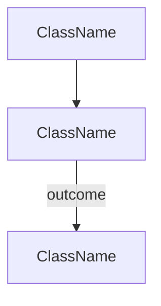

# Flow template

Copy this file into `packages/web-app/doc/flows/`. Delete this section in the copy. Add a row to [README.md](README.md).

## Rules

- One flowchart, top to bottom. A box is one class, or one kernel event named by the subscriber that handles it.
- The box label is the class name. The table under the diagram is the only place for a role and a path.
- No status lists, log lines, or header rules. Those stay in the class or the spec. One clause in the table is enough when the endpoint exists to record a status.
- The path every `/api` route shares is [api-request.md](api-request.md). An endpoint file draws only the boxes that endpoint adds, then points at the shared box it returns to.
- A command inside a service gets its own file. The endpoint file links it. The service file names the endpoint that calls it.
- English.

# Flow: <name>

<One sentence. What a reader opens this file to find.>

Shared pipeline: [API request](api-request.md). Delete this line when this file is the shared pipeline.

## Diagram

## Boxes

| Box | Role | File |
| --- | --- | --- |
| ClassName | <one clause> | [ClassName.php](../../src/...) |

## Leaves

| Outcome | Continues in | Box |
| --- | --- | --- |
| <name> | [API request](api-request.md) | <box> |

Delete this section when nothing leaves the diagram.
