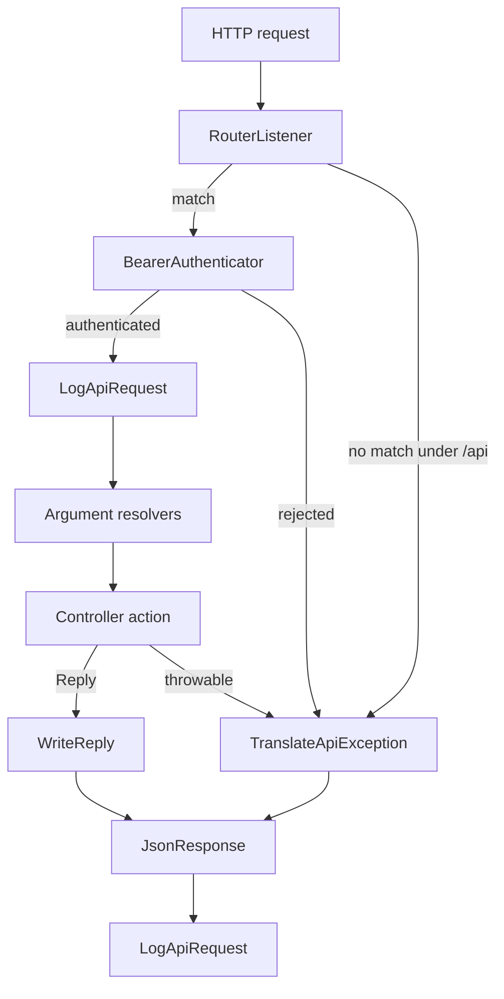

# Flow: API request

The path every route under `/api` shares, from the incoming request to the JSON response.

## Diagram

## Boxes

| Box | Role | File |
| --- | --- | --- |
| RouterListener | Matches the attribute route under the `/api` prefix. | [routes.yaml](../../config/routes.yaml) |
| BearerAuthenticator | Authenticates the firewall `api` before the controller runs. | [BearerAuthenticator.php](../../src/Api/Security/BearerAuthenticator.php) |
| LogApiRequest | On `kernel.controller`, stores the enriched request. On `kernel.response`, sets `X-Request-Id` when that request was stored. | [LogApiRequest.php](../../src/EventSubscriber/LogApiRequest.php) |
| Argument resolvers | Fill the action arguments. The endpoint flow names which resolvers. | |
| Controller action | The endpoint flow. | |
| WriteReply | Turns a `Reply` into the response through `ReplyResponder`. | [WriteReply.php](../../src/EventSubscriber/WriteReply.php) |
| TranslateApiException | Turns a throwable on `/api` into the response through `ErrorTranslator` and `ReplyResponder`. | [TranslateApiException.php](../../src/EventSubscriber/TranslateApiException.php) |
| JsonResponse | The HTTP response both exits share. | [ReplyResponder.php](../../src/Api/Response/ReplyResponder.php) |
