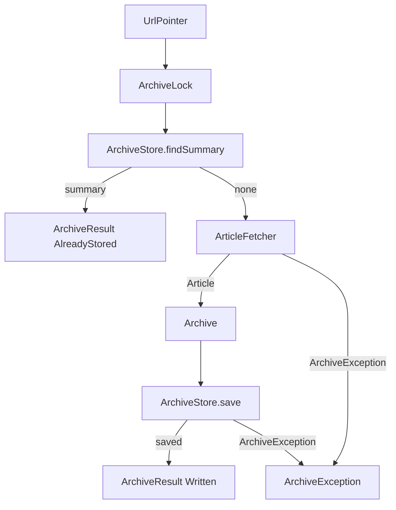

# Flow: archive service

What `ArchiveService::archive` does with one `UrlPointer` for the owner of the store it was given.

Called by [create archive](create-archive.md).

## Diagram

## Boxes

| Box | Role | File |
| --- | --- | --- |
| UrlPointer | The URL this call archives. | [UrlPointer.php](../../src/Archive/UrlPointer.php) |
| ArchiveLock | Holds that URL for the lookup, the fetch, and the save. If the lock cannot be taken, the work still runs. | [ArchiveLock.php](../../src/Archive/ArchiveLock.php) |
| ArchiveStore.findSummary | Returns the stored summary, or nothing. A hit does not fetch. | [ArchiveStore.php](../../src/Archive/ArchiveStore.php) |
| ArticleFetcher | Fetches the page. `ArticleReaderAdapter` maps a library failure to `ArchiveException`. | [ArticleFetcher.php](../../src/Archive/ArticleFetcher.php) |
| Archive | The copy built from the fetched article. | [Archive.php](../../src/Archive/Archive.php) |
| ArchiveStore.save | Stores that copy. A failure is `ArchiveException`. | [ArchiveStore.php](../../src/Archive/ArchiveStore.php) |
| ArchiveResult AlreadyStored | The summary that was already stored. | [ArchiveResult.php](../../src/Archive/ArchiveResult.php) |
| ArchiveResult Written | The summary of the copy just stored. | [ArchiveResult.php](../../src/Archive/ArchiveResult.php) |
| ArchiveException | Leaves the service. The service does not map it to a response. | [ArchiveException.php](../../src/Archive/ArchiveException.php) |

## Leaves

| Outcome | Continues in | Box |
| --- | --- | --- |
| `ArchiveResult` | [create archive](create-archive.md) | CreateArchiveController |
| `ArchiveException` | [create archive](create-archive.md) | CreateArchiveController |
