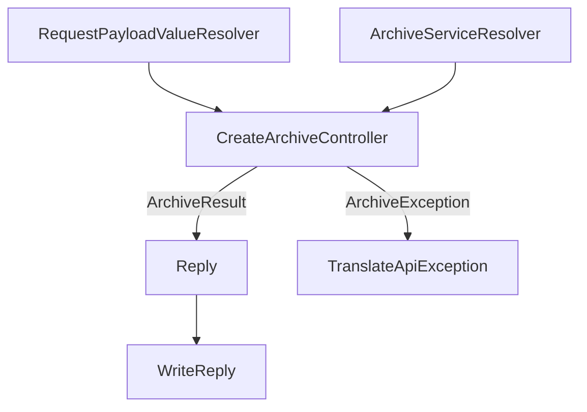

# Flow: create archive

What `POST /api/archives` adds on top of the shared request path.

Shared pipeline: [API request](api-request.md).

## Diagram

## Boxes

| Box | Role | File |
| --- | --- | --- |
| RequestPayloadValueResolver | Builds `CreateArchiveBody` from the JSON body. `#[MapRequestPayload]` on the action selects it. | [CreateArchiveController.php](../../src/Api/Controller/CreateArchiveController.php) |
| ArchiveServiceResolver | Builds `ArchiveService` for the authenticated owner. | [ArchiveServiceResolver.php](../../src/Api/Resolver/ArchiveServiceResolver.php) |
| CreateArchiveController | Builds `UrlPointer`, calls `archive`, and returns `Reply`. The call is [Archive service](archive-service.md). | [CreateArchiveController.php](../../src/Api/Controller/CreateArchiveController.php) |
| Reply | `201` when the archive was written, `200` when it was already stored. The body is `ArchiveResponse`. | [Reply.php](../../src/Api/Response/Reply.php) |
| WriteReply | Shared exit for `Reply`. | [api-request.md](api-request.md) |
| TranslateApiException | Shared exit for `ArchiveException`. The action does not catch it. | [api-request.md](api-request.md) |

## Leaves

| Outcome | Continues in | Box |
| --- | --- | --- |
| `Reply` | [API request](api-request.md) | WriteReply |
| `ArchiveException` | [API request](api-request.md) | TranslateApiException |
